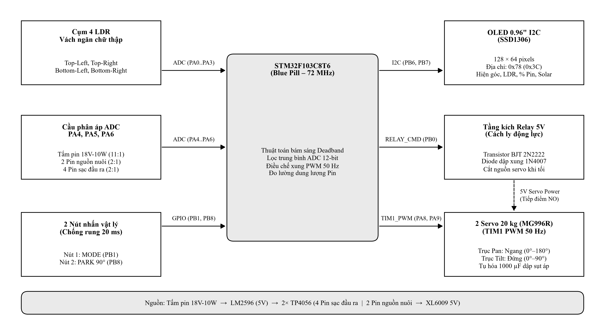

# Energy Storage with Solar Tracker System (EE3003 – Nhóm 7)

Hệ thống tích trữ năng lượng mặt trời tích hợp bám sáng tự động 2 trục (*Pan/Tilt*), thiết kế theo môn học **Thiết kế Hệ thống Nhúng (EE3003)** — Trường Đại học Bách Khoa TP.HCM (**Lớp L01 – Nhóm 7 – HK 261**).

- **Giảng viên hướng dẫn:** Nguyễn Trung Hiếu
- **Sinh viên thực hiện:**
  1. **Lê Quang Dũng** — MSSV: `2410591`
  2. **Trần Công Cường** — MSSV: `2410443`
  3. **Phạm Ngọc Huy** — MSSV: `2411260`

---

## 1. Thông số kỹ thuật chính

| Hạng mục | Thông số thiết kế |
| :--- | :--- |
| **Vi điều khiển trung tâm** | `STM32F103C8T6` (ARM Cortex-M3 32-bit, `72 MHz`, `64 KB` Flash, `20 KB` SRAM, logic `3.3V`) |
| **Tấm pin mặt trời** | `Waveshare` đa tinh thể `18V – 10W` (kích thước cạnh ~`34 cm`) |
| **Cơ cấu bám sáng 2 trục** | 2× Servo `MG996R` (`20 kg·cm`), trục `Pan: 0°–180°`, trục `Tilt: 0°–90°`, sai số `≤ ±5°` |
| **Cảm biến quang** | 4× `LDR GL5528` + cầu phân áp `10 kΩ` đặt sau vách ngăn chữ thập (`ADC 12-bit`: `PA0..PA3`) |
| **Biến đổi & Quản lý nguồn** | Buck `LM2596` (`18V → 5V / 3A`), `2× TP4056` (`1A CC/CV + DW01A`), Boost `XL6009` (`3.7V → 5V`) |
| **Lưu trữ & Nuôi hệ thống** | `4× 18650` High-Drain (lưu trữ đầu ra độc lập) + `2× 18650` (cấp qua `XL6009` nuôi hệ thống) |
| **Cách ly tải & Hiển thị** | `Relay 5V` (`PB0 → 1 kΩ → 2N2222 + 1N4007`) + tụ `1000 µF / 16V`; `OLED 0.96" I2C (SSD1306)` |
| **Kích thước & Dự toán BOM** | `250 × 250 × 400 mm`, khối lượng `2.0 – 2.5 kg`; tổng BOM phần cứng **`1.280.000 VNĐ`** |

---

## 2. Sơ đồ khối phần cứng & Cây phân phối nguồn (Power Tree)

### Sơ đồ khối phần cứng tổng thể


### Sơ đồ cây phân phối nguồn (Power Tree)


---

## 3. Bảng ánh xạ chân (`STM32F103C8T6 Pinout`)

| Chân MCU | Ngoại vi | Kết nối phần cứng | Chức năng |
| :--- | :--- | :--- | :--- |
| `PA0 – PA3` | `ADC1_IN0..3` | 4× `LDR GL5528` + `10 kΩ` | Đọc cường độ ánh sáng 4 góc |
| `PA4` | `ADC1_IN4` | Cầu phân áp `100 kΩ / 10 kΩ` (`11:1`) | Đo áp tấm pin Solar `18V` |
| `PA5` | `ADC1_IN5` | Cầu phân áp `10 kΩ / 10 kΩ` (`2:1`) | Đo áp khối `2× 18650` nguồn nuôi |
| `PA6` | `ADC1_IN6` | Cầu phân áp `10 kΩ / 10 kΩ` (`2:1`) | Đo áp khối `4× 18650` pin sạc đầu ra |
| `PA8, PA9` | `TIM1_CH1/2` | `2× Servo MG996R` (`Pan`, `Tilt`) | Xuất 2 kênh xung PWM `50 Hz` |
| `PB0` | `GPIO Output` | `1 kΩ → 2N2222 → Relay 5V` | Đóng/ngắt nguồn Servo (chống dòng rò) |
| `PB1, PB8` | `GPIO Input` | 2 nút nhấn (`MODE`, `PARK 90°`) | Điều khiển chế độ & góc an toàn `90°` |
| `PB6, PB7` | `I2C1_SCL/SDA` | `OLED 0.96"` (`4.7 kΩ` Pull-up) | Hiển thị `%` pin, góc quay & trạng thái |

---

## 4. Cấu trúc kho lưu trữ

```text
solar-tracker/
├── README.md
├── .gitignore
├── hardware/
│   ├── proteus/
│   │   └── machtest.pdsprj                          # File mô phỏng nguyên lý Proteus
│   └── diagrams/
│       ├── Hinh1_So_Do_Khoi_Solar_Tracker.png       # Sơ đồ khối phần cứng
│       └── Hinh_Power_Tree_Solar_Tracker.png        # Sơ đồ cây phân phối nguồn
├── report/
│   ├── Bao_Cao_EE3003_Nhom07_Ch1-Ch3.pdf            # Báo cáo Chương 1–3 bản PDF
│   └── latex/                                       # Mã nguồn LaTeX (main.tex + images/)
└── firmware/
    └── README.md                                    # Khu vực mã nguồn STM32 (đang cập nhật)
```

---

## 5. Tiến độ thực hiện (Roadmap)

- [x] **Chương 1:** Đặc tả yêu cầu (*Requirement Forms*)
- [x] **Chương 2:** Đặc tả hệ thống (*Product, Design, Hardware, Software & Test Specification*)
- [x] **Chương 3:** Thiết kế phần cứng (*Block Diagram, MCU Selection, Power Tree, ADC/Relay/I2C, Schematic & BOM*)
- [ ] **Chương 4:** Thiết kế phần mềm (*Software Design*) — *Đang triển khai*
- [ ] **Firmware & Thử nghiệm thực tế:** Hoàn thiện mã nguồn `STM32F103C8T6` trên `STM32CubeIDE` — *Kế tiếp*
