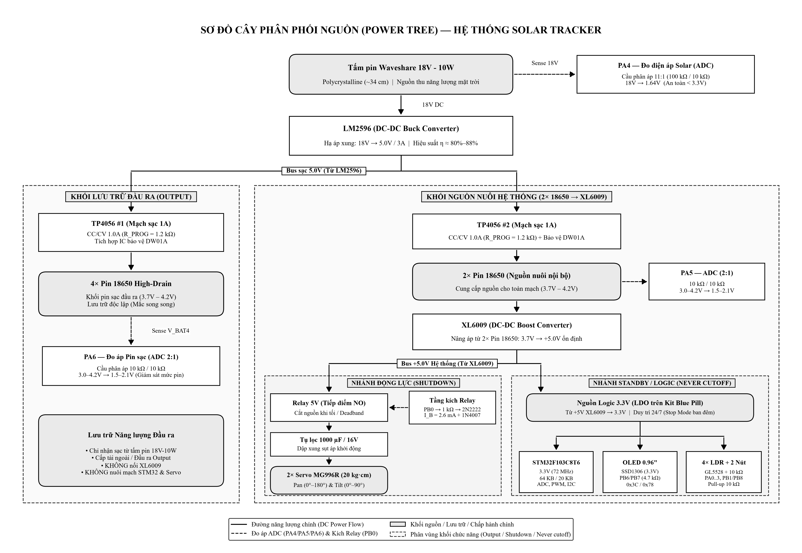

# Hệ thống Tích trữ Năng lượng Mặt trời Tích hợp Bám sáng Tự động
*(Energy Storage with Solar Tracker System)*

**Đồ án Môn học:** Thiết kế Hệ thống Nhúng (`EE3003`) — **Trường Đại học Bách Khoa TP.HCM (ĐHQG TP.HCM)**  
**Lớp:** `L01` — **Nhóm:** `7` — **Học kỳ:** `261`  
**Giảng viên hướng dẫn:** Nguyễn Trung Hiếu

| STT | Họ và tên | MSSV |
| :---: | :--- | :---: |
| 1 | Lê Quang Dũng | `2410591` |
| 2 | Trần Công Cường | `2410443` |
| 3 | Phạm Ngọc Huy | `2411260` |

---

## Yêu cầu Hệ thống (Requirement Forms)

### 1. Name
Hệ thống tích trữ năng lượng mặt trời tích hợp bám sáng tự động (*Energy Storage with Solar Tracker System*).

### 2. Purpose
Tối đa hóa hiệu suất thu thập năng lượng mặt trời thông qua cơ chế tự động bám sáng 2 trục, đồng thời quản lý an toàn quá trình tích trữ điện năng nhằm cung cấp nguồn điện sạc ổn định cho các khối pin và thiết bị ngoài lưới.

### 3. Inputs and Outputs
- **Inputs:**
  - Tín hiệu tương tự từ 4 cảm biến quang trở (`LDR GL5528`) qua bộ `ADC 12-bit` (`PA0..PA3`).
  - Nguồn năng lượng `18V DC` từ tấm pin mặt trời `Waveshare 18V–10W`.
  - Tín hiệu điện áp phản hồi từ tấm pin (`PA4`) và 2 khối pin `18650` (`PA5`, `PA6`).
- **Outputs:**
  - Xung `PWM 50 Hz` định tuyến độc lập qua Timer (`TIM1`: `PA8`, `PA9`) điều khiển 2 động cơ Servo `20 kg·cm` (`MG996R`).
  - Dòng nạp DC an toàn (`1A CC/CV`) đã qua mạch hạ áp `LM2596` (`18V → 5V`) và `2× TP4056` cấp vào khối `4× 18650` lưu trữ đầu ra và khối `2× 18650` nguồn nuôi hệ thống.
  - Dữ liệu `%` dung lượng pin, góc quay và trạng thái hiển thị trên màn hình `OLED 0.96"` (`SSD1306`) qua giao thức `I2C` (`PB6`, `PB7`).

### 4. Use Cases
- **Tự động bám sáng:** Định kỳ mỗi giây, hệ thống đọc giá trị từ 4 `LDR`. Nếu sai số ánh sáng vượt vùng dung sai (*Deadband*), vi điều khiển xuất lệnh `PWM` xoay trục `Pan` và `Tilt` để mảng pin vuông góc với hướng nắng.
- **Giám sát trạng thái Pin:** Khi ánh sáng xuống thấp (mưa bão, ban đêm), hệ thống tự động ngắt nguồn Servo qua `Relay 5V` (`PB0`) để cắt dòng rò và đưa vi điều khiển vào chế độ ngủ tiết kiệm điện. Hệ thống định kỳ thức dậy, đo lường điện áp pin `18650`, ánh xạ ra `%` và hiển thị lên màn hình `OLED`.

### 5. Functions
- **Điều hướng & Cân bằng cơ học:** Tính toán quang sai và điều khiển không gian 2 trục (`Pan` / `Tilt`) bằng cụm 2 động cơ Servo tải nặng `MG996R` (`20 kg·cm`).
- **Quản lý lưu trữ & Chia tải dòng cao:** Sử dụng mạch `LM2596` hạ áp từ `18V` xuống `5V`, nạp qua `2× TP4056` cho khối `4× 18650` lưu trữ đầu ra độc lập và khối `2× 18650` nguồn nuôi nội bộ nối `XL6009` nâng áp `+5.0V` ổn định cấp cho toàn hệ thống (`STM32`, `OLED` và `2× Servo` qua `Relay 5V`).
- **Chế độ tiết kiệm điện:** Quản trị dòng rò bằng cách ngắt nguồn ngoại vi Servo, ngủ đông khi thời tiết xấu/ban đêm và tự động khôi phục khi đủ nắng.

### 6. Performance
- **Phạm vi không gian:** Góc điều hướng bám sát đạt `0°–180°` đối với trục `Pan` và `0°–90°` đối với trục `Tilt`.
- **Độ chính xác cảm biến & định hướng:** Sai số định hướng mục tiêu `≤ ±5°`, thu thập qua `ADC 12-bit`.
- **Khả năng chịu tải:** Hệ thống không bị sụt áp gây reset vi điều khiển khi 2 động cơ Servo khởi động đồng thời (cách ly qua `Relay 5V` + tụ bù `1000 µF / 16V`).

### 7. Manufacturing Costs
- **Ngân sách vật tư dự kiến:** `1.000.000 – 1.500.000 VNĐ` (tổng dự toán thực tế: **`1.280.000 VNĐ`**).
- **Linh kiện chính:** Vi điều khiển `STM32F103C8T6`, tấm pin `Waveshare 18V–10W`, `LM2596`, `2× TP4056` (bảo vệ `DW01A`), `XL6009`, `2× Servo MG996R` (`20 kg·cm`), `6× pin 18650`, `OLED 0.96" I2C`, `Relay 5V` và linh kiện thụ động (`2N2222`, `1N4007`, tụ `1000 µF`, trở, nút nhấn).
- Xem bảng kê chi tiết 15 hạng mục tại **[hardware/BOM.md](hardware/BOM.md)** hoặc mở trực tiếp **[hardware/BOM.csv](hardware/BOM.csv)**.

### 8. Power
- **Nguồn thu:** 1 tấm quang điện đa tinh thể `Waveshare 18V–10W` (~`34 cm`).
- **Nguồn lưu trữ đầu ra (Output):** Khối `4× pin Lithium 18650` dòng xả cao (`3.7V – 4.2V`) sạc qua `TP4056 #1`, hoạt động độc lập cho tải ngoài (không nối `XL6009`, không nuôi mạch điều khiển/Servo).
- **Nguồn nuôi hệ thống:** Khối `2× pin 18650` sạc qua `TP4056 #2` nối trực tiếp bộ tăng áp `XL6009` (`+5.0V`), cấp cho nhánh động lực (`2× Servo MG996R` qua `Relay 5V` — *Shutdown*) và nhánh logic (`STM32 + OLED + LDR` qua LDO `3.3V` — *Never cutoff*), đảm bảo vi điều khiển luôn duy trì khả năng định kỳ thức dậy giám sát pin và vào chế độ ngủ an toàn khi không có ánh sáng mặt trời.

### 9. Physical Size / Weight
- **Kích thước ước tính:** `250 × 250 × 400 mm`.
- **Trọng lượng:** `2.0 kg – 2.5 kg`.

### 10. Installation
- **Không bị đổ bóng:** Tuyệt đối không bị che khuất bởi bồn nước, cột ăng-ten hay tường nhà lân cận trong khung giờ `7h00 – 16h00` để tránh chênh lệch bóng râm gây dao động đảo góc liên tục.
- **Không gian mở về hướng Nam:** Đặt thiết bị tại nơi có tầm nhìn quang đãng hướng về phía Nam để thu nhận bức xạ mặt trời cao nhất tại Việt Nam.
- **Tránh hiệu ứng ống gió:** Không đặt thiết bị tại các khe hẹp giữa hai tòa nhà cao tầng nhằm tránh gió giật mạnh tác động lên bề mặt tấm pin `34 cm`, bảo vệ cơ cấu truyền động 2 Servo.

---

## Kiến trúc Phần cứng & Cây Phân phối Nguồn

### Sơ đồ khối phần cứng tổng thể


### Sơ đồ cây phân phối nguồn (Power Tree)


---

## Cấu trúc Kho lưu trữ & Tài liệu

```text
solar-tracker/
├── README.md                                        # Tài liệu tổng quan theo Requirement Forms
├── .gitignore                                       # Lọc file tạm build CubeMX / Proteus / LaTeX
├── hardware/
│   ├── BOM.md                                       # Danh mục linh kiện chi tiết (1.280.000 VNĐ)
│   ├── BOM.csv                                      # Bảng BOM xuất Excel (UTF-8)
│   ├── proteus/
│   │   └── machtest.pdsprj                          # Sơ đồ nguyên lý mô phỏng Proteus 8
│   └── diagrams/
│       ├── Hinh1_So_Do_Khoi_Solar_Tracker.png       # Sơ đồ khối phần cứng
│       └── Hinh_Power_Tree_Solar_Tracker.png        # Sơ đồ Power Tree
├── report/
│   ├── Bao_Cao_EE3003_Nhom07_Ch1-Ch3.pdf            # Báo cáo Chương 1–3 bản PDF
│   └── latex/                                       # Mã nguồn LaTeX (main.tex + images/)
└── firmware/
    └── README.md                                    # Khu vực mã nguồn STM32F103C8T6 (đang triển khai)
```

- **Báo cáo đầy đủ (PDF Chương 1–3):** [report/Bao_Cao_EE3003_Nhom07_Ch1-Ch3.pdf](report/Bao_Cao_EE3003_Nhom07_Ch1-Ch3.pdf)
- **Mã nguồn báo cáo LaTeX (Overleaf-ready):** [report/latex/main.tex](report/latex/main.tex)
- **Mạch mô phỏng Proteus:** [hardware/proteus/machtest.pdsprj](hardware/proteus/machtest.pdsprj)
- **Danh mục linh kiện (BOM):** [hardware/BOM.md](hardware/BOM.md) | [hardware/BOM.csv](hardware/BOM.csv)

---

## Tiến độ Thực hiện (Roadmap)

- [x] **Chương 1:** Đặc tả yêu cầu (*Requirement Forms*)
- [x] **Chương 2:** Đặc tả hệ thống (*Product, Design, Hardware, Software & Test Specification*)
- [x] **Chương 3:** Thiết kế phần cứng (*Block Diagram, MCU Selection, Power Tree, ADC/Relay/I2C, Schematic & BOM*)
- [ ] **Chương 4:** Thiết kế phần mềm (*Software Design*) — *Đang triển khai*
- [ ] **Firmware & Thử nghiệm thực tế:** Hoàn thiện mã nguồn `STM32F103C8T6` trên `STM32CubeIDE` — *Kế tiếp*
