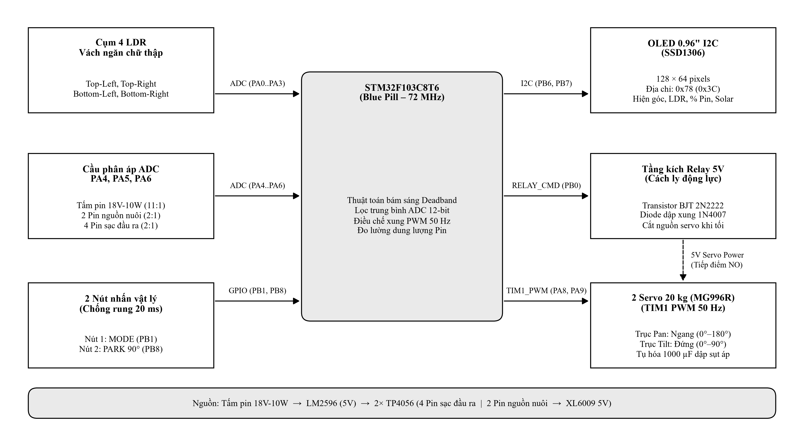

# Đặc tả Hệ thống (System & Design Specification)

Thư mục này lưu trữ tài liệu đặc tả kỹ thuật đầy đủ cho đồ án **Hệ thống Tích trữ Năng lượng Mặt trời Tích hợp Bám sáng Tự động (*Energy Storage with Solar Tracker System*)** — Môn `EE3003`, Lớp `L01`, Nhóm `7`, HK `261`, được tách riêng theo 2 tài liệu chuyên biệt:

- **[Hardware Specification (`hardware_spec.md`)](hardware_spec.md):** Đặc tả chi tiết phần cứng (`STM32F103C8T6`, ánh xạ chân Pinout, nguồn `18V-10W`, `LM2596`, `2× TP4056`, `XL6009`, `4× 18650` Output & `2× 18650` nuôi hệ thống, `2× MG996R`, `OLED`, `Relay 5V + 1000 µF`) và **Đặc tả kiểm thử phần cứng (Test Hardware Specification)**.
- **[Software Specification (`software_spec.md`)](software_spec.md):** Đặc tả chi tiết phần mềm (*bare-metal* 6 module, giao diện phần cứng/phần mềm, 3 chức năng cốt lõi, lưu đồ giải thuật bám sáng 2 trục, ràng buộc hiệu năng và thuộc tính hệ thống).

---

## 1. Mô tả Thiết kế Hệ thống (Design Specification)

### Góc nhìn kỹ sư thiết kế
Hệ thống là một thiết bị nhúng thời gian thực giải quyết 3 bài toán kỹ thuật chính:
1. **Phân áp an toàn:** Hạ điện áp hở mạch cực đại của tấm pin `18V` (tối đa ~`22V`) qua cầu trở `100 kΩ / 10 kΩ` (`11:1`) và điện áp khối pin `4.2V` qua cầu `10 kΩ / 10 kΩ` (`2:1`) về dải `0 – 2.1V` an toàn cho chân `ADC 3.3V` của `STM32F103C8T6`.
2. **Cách ly động lực chống sụt áp:** Phân tách đường nguồn động lực của `2× Servo MG996R` (`20 kg·cm`) qua `Relay 5V` (`PB0 → 1 kΩ → 2N2222 + 1N4007`) và tụ hóa bù áp `1000 µF / 16V` để triệt tiêu sụt áp gây reset vi điều khiển khi 2 Servo khởi động đồng thời.
3. **Quản lý năng lượng hai nhánh tách biệt:** Bộ hạ áp `LM2596` (`18V → 5V`) nạp qua `2× TP4056` độc lập cho khối **`4× 18650` lưu trữ đầu ra (Output)** và khối **`2× 18650` nguồn nuôi hệ thống** nối qua bộ tăng áp `XL6009` (`+5.0V`).

### Kiến trúc tổng thể
- **Hardware:** `STM32F103C8T6`, 4× `LDR GL5528`, 2× `Servo MG996R` (`20 kg·cm`), `Relay 5V` (`2N2222 + 1N4007 + 1000 µF`), tấm pin `Waveshare 18V–10W`, `LM2596`, `2× TP4056`, `XL6009`, `6× cell 18650`, `OLED 0.96" I2C (SSD1306)`, 2 nút nhấn (`MODE`, `PARK 90°`).
- **Software:** Hiệu chuẩn & lọc trung bình 4 `LDR`, thuật toán bám sáng 2 trục (`Pan` / `Tilt`), điều chế xung `PWM 50 Hz`, giám sát điện áp 2 khối pin & tấm Solar, hiển thị `OLED` và quản trị nguồn (`Stop Mode` / `Sleep Mode`).
- **Interface:** `ADC 12-bit` (`PA0..PA6`), `I2C1` (`400 kHz`, `PB6/PB7`), `TIM1 PWM 50 Hz` (`PA8/PA9`), `GPIO` (`PB0`, `PB1`, `PB8`, `PC13`).

---

## 2. Phân rã Chức năng Bậc một (First-Order Functional Decomposition)

| Mã khối | Tên chức năng | Nhiệm vụ chính |
| :--- | :--- | :--- |
| **F1** | Thu nhận bức xạ & Đo lường | Đọc cường độ sáng từ 4 `LDR` (`PA0..PA3`) qua `ADC 12-bit`; đo áp tấm pin `18V` (`PA4`), khối `2× 18650` nguồn nuôi (`PA5`) và khối `4× 18650` pin sạc đầu ra (`PA6`). |
| **F2** | Xử lý tín hiệu & Bám sáng | Lọc trung bình 4 mẫu ADC; tính quang sai `dH`, `dV`; kiểm tra vùng dung sai (*Deadband* `tol = 25`) chống rung lắc; đánh giá điều kiện Ngày/Đêm. |
| **F3** | Chấp hành cơ khí & Cách ly | Xuất 2 kênh xung `PWM 50 Hz` độc lập điều khiển `Pan` (`0°–180°`) và `Tilt` (`0°–90°`); điều khiển `Relay 5V` (`PB0`) cắt nguồn Servo khi ổn định hoặc trời tối. |
| **F4** | Biến đổi năng lượng & Tích trữ | Hạ áp `LM2596` (`18V → 5V`), sạc `2× TP4056` (`1A CC/CV`) cho `4× 18650` lưu trữ đầu ra và `2× 18650` nguồn nuôi nối `XL6009` (`+5.0V`). |
| **F5** | Giao diện hiển thị & Ngủ đông | Hiển thị `%` pin 2 khối, điện áp Solar, góc quay lên `OLED 0.96"` qua `I2C`; đưa MCU vào chế độ ngủ khi tối và thức dậy định kỳ kiểm tra. |

---

## Tài liệu liên quan
- [Danh mục Linh kiện (hardware/LinhKien.md)](../hardware/LinhKien.md) | [File CSV](../hardware/LinhKien.csv)
- [Báo cáo đầy đủ PDF Chương 1–3](../report/Bao_Cao_EE3003_Nhom07_Ch1-Ch3.pdf)
