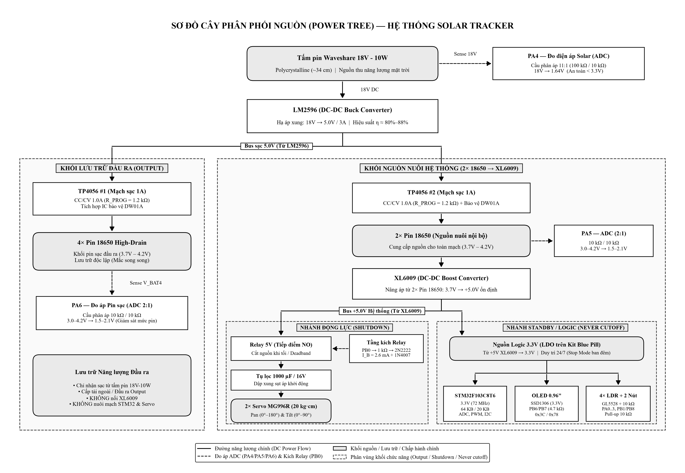
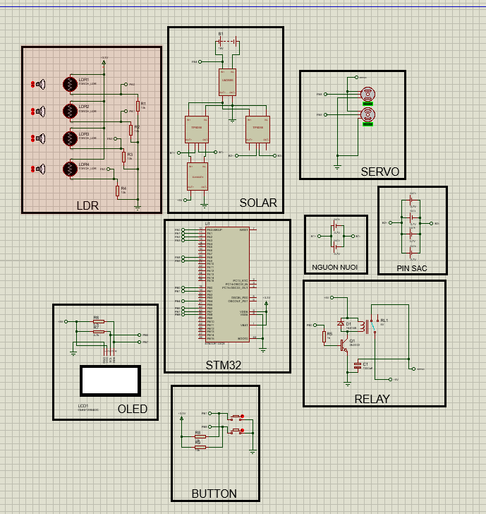

# Hardware Specification — Đặc tả Phần cứng

Tài liệu này mô tả chi tiết từng khối phần cứng, bảng ánh xạ chân (`Pinout`), sơ đồ phân phối nguồn, mạch bảo vệ và bảng tiêu chuẩn kiểm thử phần cứng của hệ thống **Energy Storage with Solar Tracker System** (`EE3003 – Nhóm 7`).

> Xem danh mục vật tư và chi phí dự toán (`1.280.000 VNĐ`) tại [hardware/LinhKien.md](../hardware/LinhKien.md).

---

## 1. Vi điều khiển `STM32F103C8T6` & Bảng ánh xạ chân (`Pinout`)

Bộ điều khiển trung tâm **`STM32F103C8T6`** (ARM Cortex-M3 32-bit, xung nhịp `72 MHz`, `64 KB` Flash, `20 KB` SRAM, mức logic `3.3V`, hỗ trợ chế độ ngủ tiết kiệm điện `Sleep` / `Stop Mode`) kết nối với ngoại vi theo bảng sau:

| Chân STM32 | Ngoại vi | Kết nối phần cứng | Chức năng |
| :--- | :--- | :--- | :--- |
| `PA0 – PA3` | `ADC1_IN0..3` | 4 cầu chia áp `LDR GL5528` (`10 kΩ`) | Đọc cường độ ánh sáng 4 góc (`12-bit`) |
| `PA4` | `ADC1_IN4` | Cầu phân áp `100 kΩ / 10 kΩ` (`11:1`) | Đo điện áp tấm pin `18V` (`22V → 2.0V`) |
| `PA5` | `ADC1_IN5` | Cầu phân áp `10 kΩ / 10 kΩ` (`2:1`) | Đo áp & `%` khối `2× 18650` nguồn nuôi (`4.2V → 2.1V`) |
| `PA6` | `ADC1_IN6` | Cầu phân áp `10 kΩ / 10 kΩ` (`2:1`) | Đo áp & `%` khối `4× 18650` pin sạc đầu ra (`4.2V → 2.1V`) |
| `PA8, PA9` | `TIM1_CH1/2` | 2× Servo `MG996R` (`Pan`, `Tilt`) | Xuất 2 kênh xung `PWM 50 Hz` độc lập |
| `PB0` | `GPIO Output` | Trở `1 kΩ` → BJT `2N2222` → `Relay 5V` | Đóng/ngắt nguồn 2 Servo (chống dòng rò / ban đêm) |
| `PB1, PB8` | `GPIO Input` | 2 nút nhấn (`MODE`, `PARK 90°`) + `10 kΩ` | Chuyển chế độ & đưa tấm pin về góc `90°` an toàn |
| `PB6, PB7` | `I2C1_SCL/SDA` | Màn hình `OLED 0.96"` (trở kéo `4.7 kΩ`) | Truyền dữ liệu hiển thị `%` pin, góc quay & trạng thái |
| `PA13, PA14` | `SWDIO, SWCLK` | Mạch nạp `ST-Link V2` | Nạp firmware và gỡ lỗi thời gian thực (`SWD`) |
| `PC13` | `GPIO Output` | LED trạng thái trên kit Blue Pill | Báo nhịp hoạt động (*heartbeat*) của hệ thống |

---

## 2. Đặc tả chi tiết các Khối phần cứng

### 2.1. Cảm biến ánh sáng `LDR GL5528`
- **Cấu trúc bố trí:** 4 quang trở `GL5528` bố trí đối xứng 4 góc quanh vách ngăn chữ thập chắn sáng để phân biệt độ chênh lệch ánh sáng theo 2 trục ngang (`Pan`) và đứng (`Tilt`).
- **Nguyên lý phần cứng:** Mỗi `LDR` mắc nối tiếp với điện trở cố định `10 kΩ` tạo cầu phân áp giữa `+3.3V` và `GND`; điện áp điểm giữa (`0.2V – 3.1V`) đưa về `PA0..PA3` để `ADC 12-bit` đọc về.

### 2.2. Động cơ `Servo MG996R` (`20 kg·cm`)
- Sử dụng 2 động cơ Servo tải nặng `MG996R` (mô-men xoay `20 kg·cm`) để nâng và xoay ổn định mảng pin `34 cm` cùng khung cơ khí trọng lượng `2.0 – 2.5 kg`:
  - **Servo Pan (`PA8`):** Quay phương ngang trong dải `0° – 180°`.
  - **Servo Tilt (`PA9`):** Ngẩng phương đứng trong dải `0° – 90°`.
- **Đặc tả điều khiển:** Điều khiển bằng 2 kênh `PWM 50 Hz` độc lập từ `TIM1`, cấp nguồn riêng qua tiếp điểm `NO` của `Relay 5V` kèm tụ hóa `1000 µF / 16V` đáp ứng dòng khởi động đồng thời của cả 2 Servo.

### 2.3. Tấm pin năng lượng mặt trời `Waveshare 18V – 10W`
- Tấm quang điện đa tinh thể (*Polycrystalline*) `Waveshare 18V – 10W` (kích thước cạnh ~`34 cm`, điện áp danh định `18V`), đóng vai trò nguồn thu chính cấp điện áp DC đầu vào cho khối hạ áp và sạc pin.

### 2.4. Module hạ áp & Sạc pin (`LM2596` & `2× TP4056`)
- **Module giảm áp Buck `LM2596`:** Hạ áp từ `18V` xuống bus chuẩn `5.0V` (dòng tải tối đa `3A`) cấp cho tầng sạc pin.
- **Module sạc Lithium `TP4056` (2 mạch độc lập):** Quản lý sạc an toàn 3 giai đoạn (`Trickle Charge → CC 1A → CV 4.2V` và tự ngắt khi dòng giảm về `~100 mA`), tích hợp mạch bảo vệ `DW01A` + MOSFET kép cho cả 2 cụm pin `18650`.

### 2.5. Khối lưu trữ đầu ra (`4× 18650`) & Nguồn nuôi hệ thống (`2× 18650` → `XL6009`)
- **Khối lưu trữ đầu ra (`4× 18650` High-Drain):** Mắc song song (`3.7V – 4.2V`), nhận sạc từ `TP4056 #1`, hoạt động như **khối pin sạc lưu trữ đầu ra (Output) độc lập** cho tải ngoài (không nối qua `XL6009` và không nuôi mạch điều khiển/Servo). Điện áp phản hồi qua cầu `10 kΩ / 10 kΩ` về `PA6`.
- **Khối nguồn nuôi hệ thống (`2× 18650` + Boost `XL6009`):** Sạc độc lập qua `TP4056 #2` (đo áp qua `PA5`) và nối trực tiếp vào bộ tăng áp `XL6009` nâng từ `3.7V – 4.2V` lên `+5.0V` ổn định nuôi toàn bộ hệ thống:
  - **Nhánh Logic (*Never cutoff*):** Qua bộ ổn áp LDO trên kit Blue Pill hạ xuống `3.3V` nuôi liên tục `STM32`, `OLED`, cụm `LDR` và nút nhấn (kể cả khi thiếu nắng/ban đêm).
  - **Nhánh Động lực (*Shutdown function*):** Qua tiếp điểm `NO` của `Relay 5V` cấp cho `2× Servo MG996R`.

### 2.6. Module hiển thị (`OLED 0.96" I2C`)
- Màn hình `OLED 0.96"` (`SSD1306`, độ phân giải `128 × 64`) giao tiếp `I2C1` qua `PB6/PB7` (`400 kHz`, địa chỉ 7-bit `0x3C` / 8-bit `0x78`), hiển thị `%` pin 2 khối, điện áp Solar, góc `Pan/Tilt` và trạng thái hệ thống.

### 2.7. Mạch cách ly động lực `Relay 5V` & Tụ chống sụt áp
- **Mạch kích & bảo vệ Relay:** Chân `PB0` điều khiển BJT NPN `2N2222` qua trở hạn dòng `1 kΩ` ($I_B \approx 2.6\text{ mA}$) để đóng/ngắt cuộn hút `Relay 5V` (`≈ 70 mA`); mắc song song ngược cực diode `1N4007` dập xung cảm ứng bảo vệ BJT.
- **Tụ hóa chống sụt áp `1000 µF / 16V`:** Tiếp điểm `COM` nối `+5V` từ `XL6009`, tiếp điểm `NO` cấp nguồn cho 2 Servo kèm tụ hóa `1000 µF / 16V` nối xuống `GND` để bù dòng đề-pa tức thời, chống sụt áp reset `STM32`.

---

## 3. Đặc tả Kiểm thử Phần cứng (Test Hardware Specification)

| Module kiểm thử | Phương pháp kiểm tra | Kết quả mong đợi (Định lượng) |
| :--- | :--- | :--- |
| **`STM32F103C8T6`** | Cấp nguồn `5V` vào bo, kiểm tra áp nội `3.3V` và LED trạng thái `PC13`. | Điện áp logic đạt `3.3V ± 0.05V`, chip khởi động ổn định, vào/thoát chế độ ngủ đúng chu kỳ. |
| **Cụm 4 `LDR`** | Chiếu đèn pin lần lượt vào từng quang trở và đo điện áp tại `PA0..PA3`. | Điện áp biến thiên trong dải `0.2V – 3.1V` theo độ sáng, giá trị `ADC 12-bit` (`0–4095`) ổn định. |
| **Cầu phân áp đo áp** | Cấp áp chuẩn `18V` (Solar) và `4.2V` (Pin), đo áp tại `PA4`, `PA5`, `PA6`. | `PA4 ≈ 1.64V` (tối đa `2.0V` ở `22V`); `PA5, PA6 ≈ 2.10V` ở `4.2V` (luôn `≤ 3.3V`). |
| **`2× Servo MG996R`** | Xuất xung `PWM 50 Hz` độc lập trên `PA8`, `PA9` kiểm tra toàn dải góc. | Trục `Pan` xoay đúng `0°–180°`, trục `Tilt` xoay đúng `0°–90°`, sai số góc `≤ ±5°`. |
| **`Relay 5V` & Tụ `1000 µF`** | Kích `PB0 = 0/1` và cho 2 Servo khởi động đồng thời; đo áp bus `5V`. | `PB0 = 0` cắt nguồn Servo về `0V`; `PB0 = 1` cấp đủ `5V`; bus `5V` không tụt dưới `4.75V`, `STM32` không reset. |
| **`LM2596`** | Cấp `18V` từ tấm pin / nguồn DC vào `IN+/IN-`, đo áp ngõ ra `OUT+/OUT-`. | Điện áp ngõ ra đạt chuẩn `5.0V ± 0.1V` ổn định khi có tải sạc. |
| **`TP4056`** | Cấp `5V` vào `IN+/IN-` sạc cho khối pin `18650`, theo dõi đèn báo và áp pin. | Đèn đỏ sáng khi đang sạc (`≈ 1A`), tự chuyển xanh và ngắt sạc khi pin đạt `4.2V ± 0.05V`. |
| **`XL6009`** | Cấp nguồn từ khối `2× 18650` (`3.7V–4.2V`) vào ngõ vào, đo ngõ ra có tải. | Điện áp ngõ ra tăng ổn định đạt `5.0V ± 0.1V`. |
| **Pin `18650`** | Đo điện áp hở mạch và khi có tải của khối 4 pin đầu ra & khối 2 pin nguồn nuôi. | Điện áp nằm trong giới hạn an toàn `3.0V – 4.2V`; khối 2 pin nuôi ổn định `STM32` & `OLED` khi rút nguồn Solar. |
| **`OLED 0.96" I2C`** | Gửi dữ liệu mẫu qua `PB6/PB7` (`400 kHz`, địa chỉ `0x3C / 0x78`). | Hiển thị rõ nét `%` pin, góc quay và trạng thái hệ thống, không sọc hình hay treo bus I2C. |
