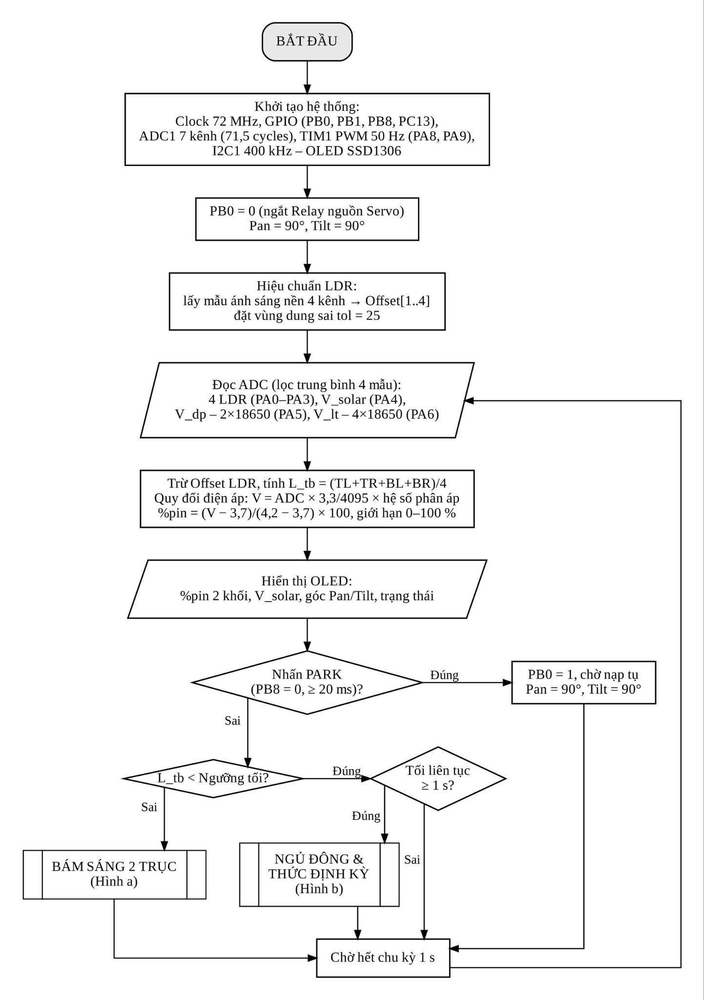
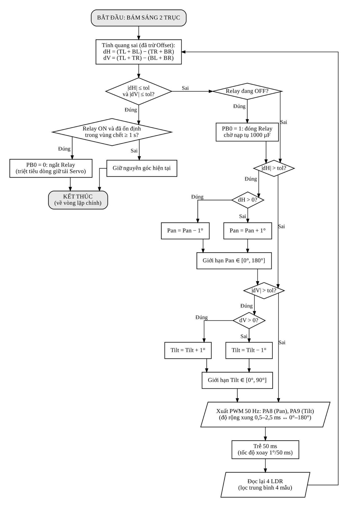

# Software Specification — Đặc tả Phần mềm

Tài liệu này mô tả giao diện phần cứng/phần mềm, đặc tả 3 nhóm chức năng chính, lưu đồ giải thuật, yêu cầu hiệu năng, ràng buộc thiết kế và thuộc tính hệ thống cho firmware `STM32F103C8T6` của đồ án **Energy Storage with Solar Tracker System** (`EE3003 – Nhóm 7`).

---

## 1. Giao diện Bên ngoài (External Interfaces)

### 1.1. Giao diện kết nối phần cứng
Phần mềm nhúng trên vi điều khiển `STM32F103C8T6` giao tiếp trực tiếp với các ngoại vi phần cứng thông qua các chuẩn tín hiệu sau:
- **Ngõ vào `ADC 12-bit` (7 kênh trên `ADC1`):**
  - 4 kênh (`PA0..PA3`): Đọc tín hiệu điện áp tương tự từ 4 cảm biến quang trở (`LDR GL5528`) để xác định hướng ánh sáng mạnh nhất.
  - 3 kênh (`PA4..PA6`): Đọc điện áp tấm pin Solar (`PA4`, cầu `11:1`), khối `2× 18650` nguồn nuôi hệ thống (`PA5`, cầu `2:1`) và khối `4× 18650` pin sạc đầu ra (`PA6`, cầu `2:1`).
- **Ngõ ra `PWM 50 Hz` (2 kênh `TIM1` độc lập):** Xuất xung điều khiển góc quay cho 2 động cơ `Servo MG996R` trên trục `Pan` (`PA8`, `0°–180°`) và trục `Tilt` (`PA9`, `0°–90°`).
- **Giao tiếp `I2C1` (`PB6/PB7`, `400 kHz`):** Truyền dữ liệu `%` dung lượng 2 khối pin, điện áp Solar, góc quay và trạng thái lên màn hình `OLED 0.96" SSD1306` (`0x3C / 0x78`).
- **GPIO điều khiển & Nút nhấn:**
  - `PB0` (`GPIO Output`): Đóng/ngắt nguồn `2× Servo` qua `Relay 5V` + tụ bù `1000 µF`.
  - `PB1` (`MODE`), `PB8` (`PARK 90°`) (`GPIO Input`, chống rung `≥ 20 ms`): Điều khiển thao tác người dùng.
  - `PC13` (`GPIO Output`): LED trạng thái hệ thống.

### 1.2. Giao diện phần mềm
Hệ thống được xây dựng theo kiến trúc **bare-metal** (không sử dụng RTOS, không dùng bộ nhớ ngoài và không tích hợp CSDL ngoài):
- **Lớp truy cập phần cứng MCU:** 6 module ứng dụng (`Sensor Processing`, `Sun Tracking Algorithm`, `Servo Control Algorithm`, `Battery Monitoring`, `Power Management`, `System Control`) giao tiếp thanh ghi ngoại vi `STM32F103C8T6` qua thư viện `STM32 HAL/LL Driver` trên `STM32CubeIDE`.
- **Trình điều khiển đồ họa OLED (`SSD1306`):** Module hiển thị thao tác qua vùng đệm khung hình tĩnh (**Frame Buffer `1024 Bytes`** trong SRAM nội) trước khi đẩy đồng bộ ra ngoại vi `I2C1`.

---

## 2. Yêu cầu Chức năng (Functions)

### 2.1. Chức năng 1 — Xử lý cảm biến & Điều hướng bám sáng tự động 2 trục
1. **Xử lý cảm biến:**
   - **Thu thập & ánh xạ kênh ADC:** Định kỳ mỗi `1 giây` (khi đủ nắng), đọc 4 kênh `ADC 12-bit` từ 4 `LDR` (lọc trung bình 4 mẫu), ánh xạ thành 2 cặp đối xứng: Trái – Phải (`Pan`) và Trên – Dưới (`Tilt`).
   - **Hiệu chuẩn cảm biến (*Calibration Phase*):** Khi khởi động tại vị trí lắp đặt thực tế, hệ thống lấy mẫu nền để tính giá trị bù lệch `Offset[1..4]` và thiết lập vùng dung sai (`Deadband tol = 25`).
2. **Thuật toán bám sáng:**
   - Tính độ chênh lệch ánh sáng đã trừ Offset:
     - `dH = (TL + BL) - (TR + BR)` *(trục ngang Pan)*
     - `dV = (TL + TR) - (BL + BR)` *(trục đứng Tilt)*
   - Nếu `|dH| ≤ tol` và `|dV| ≤ tol`: giữ nguyên góc hiện tại (tránh quay lắc liên tục gây hao pin). Nếu ổn định trong vùng chết `≥ 1 s`, ngắt `Relay 5V` (`PB0 = 0`) để cắt dòng giữ tải Servo.
   - Nếu vượt ngưỡng dung sai: đóng `Relay 5V` (`PB0 = 1`, chờ nạp tụ `1000 µF`), điều chỉnh từng bước `1° / 50 ms` đưa tấm pin vuông góc hướng nắng (sai số định hướng `≤ ±5°`).
3. **Điều khiển động cơ Servo:**
   - Xuất xung `PWM 50 Hz` (`0.5 – 2.5 ms`) độc lập qua `TIM1` kẹp trong giới hạn cơ học `Pan ∈ [0°, 180°]` và `Tilt ∈ [0°, 90°]`, đảm bảo không sụt áp reset MCU khi 2 Servo chạy đồng thời.

### 2.2. Chức năng 2 — Giám sát & Hiển thị dung lượng 2 khối Pin `18650`
- Đọc giá trị `ADC 12-bit` (`0–4095`) trên `PA5` (`2× 18650` nguồn nuôi) và `PA6` (`4× 18650` pin sạc đầu ra) theo chu kỳ `1 s` ban ngày và mỗi lần thức dậy vào ban đêm.
- Quy đổi về điện áp thực (`V = ADC × 3.3 / 4095 × hệ số phân áp`), ánh xạ sang `%` dung lượng trong dải `3.7V – 4.2V` (giới hạn `0–100%`) và hiển thị trực quan lên `OLED` qua `I2C1`.

### 2.3. Chức năng 3 — Quản lý nguồn điện (Ngủ đông & Khôi phục)
- **Kích hoạt chế độ ngủ:** Khi cường độ sáng trung bình `L_tb < Ngưỡng tối` liên tục `≥ 1 s` (ban đêm, mưa bão), ngắt `Relay` Servo (`PB0 = 0`) và đưa `STM32` vào chế độ ngủ tiết kiệm điện (nuôi bởi nguồn `2× 18650 → XL6009`).
- **Giám sát định kỳ khi ngủ:** Định kỳ thức dậy (`30 phút/lần`) đọc điện áp 2 khối pin, cập nhật màn hình `OLED`; nếu trời vẫn tối thì quay lại ngủ an toàn.
- **Tự động khôi phục:** Khi ánh sáng đạt ngưỡng đủ nắng trở lại, đánh thức vi điều khiển và khôi phục chu trình bám sáng 2 trục.

### 2.4. Lưu đồ Thuật toán Chức năng

| Lưu đồ tổng quát hệ thống | Lưu đồ giải thuật bám sáng 2 trục |
| :---: | :---: |
|  |  |

---

## 3. Yêu cầu Tính khả dụng & Hiệu năng

### 3.1. Tính khả dụng (*Usability Requirements*)
- Hiển thị rõ ràng, tách biệt `%` dung lượng của khối `4× 18650` (Output) và khối `2× 18650` (nguồn nuôi) trên màn hình `OLED`.
- Vận hành tự động hoàn toàn ngoài lưới: tự hiệu chuẩn khi khởi động, tự bám sáng ban ngày và tự ngủ đông ban đêm không cần thao tác thủ công.

### 3.2. Hiệu năng (*Performance Requirements*)
- **Chu kỳ đáp ứng bám sáng:** Đọc cảm biến & cập nhật điều khiển định kỳ mỗi `1 giây` (bước chỉnh góc `1° / 50 ms`).
- **Phạm vi góc điều khiển:** `0° – 180°` (trục `Pan`) và `0° – 90°` (trục `Tilt`).
- **Độ chính xác định hướng:** Sai số góc mục tiêu `≤ ±5°`.
- **Độ phân giải đo lường:** `ADC 12-bit` (`71.5 cycles`) cho 4 `LDR`, áp Solar và 2 khối pin.
- **Chịu tải đồng thời:** Không gây sụt áp reset `STM32` khi 2 Servo `MG996R` khởi động cùng lúc.

---

## 4. Ràng buộc Thiết kế & Thuộc tính Hệ thống

### 4.1. Ràng buộc thiết kế (*Design Constraints*)
- **Ràng buộc điện áp MCU:** Mọi chân `STM32F103C8T6` tuyệt đối không vượt quá `3.3V` (phần mềm quy đổi đúng theo cầu phân áp `11:1` ở `PA4` và `2:1` ở `PA5, PA6`).
- **An toàn pin Lithium & công suất module:** Giám sát pin trong ngưỡng an toàn, chèn trễ nạp tụ `1000 µF` khi đóng Relay, vận hành phù hợp giới hạn phần cứng của `LM2596` (`18V → 5V`), `TP4056` (`1A CC/CV`) và `XL6009` (công suất đỉnh `< 12.5W`).

### 4.2. Thuộc tính hệ thống phần mềm (*Software System Attributes*)
- **Độ tin cậy:** Vận hành liên tục 24/7 nhờ lọc trung bình 4 mẫu, giới hạn tốc độ quay `1° / 50 ms`, trễ nạp tụ khi đóng Relay và LED báo trạng thái `PC13`.
- **Ổn định trước nhiễu môi trường:** Vùng chết `tol = 25` triệt tiêu rung lắc quanh điểm cân bằng; độ trễ ngắt Relay `1.0 s` tránh tắt nhầm khi mây/bóng lướt qua cảm biến.
- **Khả năng bảo trì & mở rộng:** Mã nguồn tách rõ 6 module chức năng độc lập, tập trung tham số hiệu chuẩn để dễ kiểm thử từng phần.
